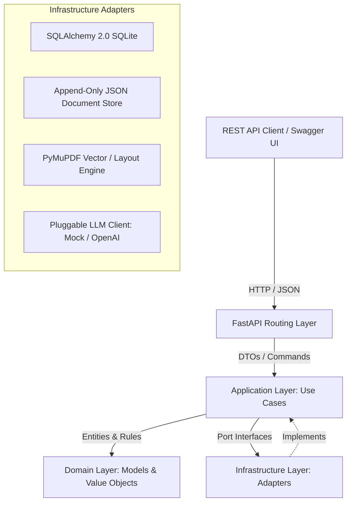

# Tri9T AI CT-200 Regulatory Manual Traceability & QA Suite

A modular, production-grade backend for versioned medical device manual extraction, cross-version requirement lineage tracking, version-pinned test case generation, and retrieval-time staleness analysis.

---

## 1. System Overview

In medical device engineering, regulatory manuals (e.g., instructions for use, technical specifications, safety alarms) undergo revisions across product lifecycles. Verifying these devices requires maintaining verifiable, immutable QA test cases while immediately detecting when newer manual releases render existing test cases stale.

The **Tri9T AI CT-200 Suite** solves this by providing:
- **Two-Tier PDF Extraction & Hierarchy Reconstruction**: Extracts selectable text, layout coordinates, font styling, and multi-line tables into an AST without inventing hallucinated nodes.
- **Immutable Document Versioning & Content Hashing**: Fingerprints source PDFs and individual node versions with SHA-256 hashes to guarantee historical immutability.
- **Cross-Version Lineage Tracking**: Decouples persistent `LogicalNode` identities from revision-specific `NodeVersion` snapshots using a 3-pass matching algorithm.
- **Version-Pinned Selections**: Locks test scopes to exact node versions and content hashes, preventing silent requirement drift.
- **Validated QA Generation**: Synthesizes structured test suites using a pluggable `LLMClient` with schema enforcement and a self-healing 1-retry recovery loop.
- **Hybrid Storage Architecture**: Uses **SQLite (SQLAlchemy 2.0)** for relational hierarchy and indexed queries, and an **Append-Only JSON Document Store** (MongoDB-compatible) for generated test suites.
- **Retrieval-Time Staleness & Impact Reporting**: Dynamically compares pinned snapshots against the latest manual revision without modifying stored artifacts, categorizing impact with deterministic heuristics.

---

## 2. Architecture & Design Principles



- **Modular Monolith**: Strict separation between API, Application, Domain, and Infrastructure layers.
- **Zero Business Logic in Routes**: Route handlers act purely as HTTP serialization and parameter-validation boundaries.
- **Zero LLM Calls for Staleness**: All staleness and impact classifications are deterministic, reproducible, and offline.

---

## 3. Installation & Setup

### Prerequisites
- Python 3.11, 3.12, or 3.13
- Git

### 1. Clone & Set Up Virtual Environment
```bash
# Clone the repository
git clone https://github.com/ANUMULASAISANTHOSH/ct200-traceability-qa-pipeline.git
cd ct200-traceability-qa-pipeline

# Create and activate virtual environment
python -m venv venv

# On Windows (PowerShell):
.\venv\Scripts\Activate.ps1
# On macOS / Linux:
source venv/bin/activate
```

### 2. Install Dependencies
```bash
pip install -r requirements.txt
```

### 3. Source Manual Placement
Ensure the two source PDF manuals are placed in the `data/` directory (these are kept as local test data outside Git tracking):
- `data/ct200_manual.pdf`
- `data/ct200_manual_v2.pdf`

### 4. Environment Configuration
Copy the example environment configuration:
```bash
cp .env.example .env
```

Default configuration in `.env`:
```ini
APP_NAME="CT-200 Document Verification System"
APP_ENV=development
DATABASE_URL="sqlite:///./ct200_app.db"
JSON_STORE_PATH="./data/generations"
MOCK_LLM=true
# Optional Real Provider Config:
OPENAI_API_KEY=""
OPENAI_MODEL="gpt-4o-mini"
```

*Note: By default, `MOCK_LLM=true` is enabled. The system operates completely offline without requiring any API keys or network calls.*

---

## 4. Running the End-to-End Demonstration

A complete, self-contained demonstration script walks through the entire regulatory lifecycle:
1. Ingesting CT-200 v1 PDF and inspecting its extracted section hierarchy.
2. Creating an immutable version-pinned selection of critical safety and specification nodes.
3. Synthesizing validated QA test cases using the deterministic mock LLM adapter.
4. Ingesting CT-200 v2 PDF and detecting additions, removals, and specification modifications.
5. Retrieving the v1 generation and displaying dynamic staleness evaluation and transparent heuristic impact tags.

Run the demo with:
```bash
python scripts/demo_e2e.py
```

---

## 5. Running the Test Suite

The repository includes a comprehensive automated test suite (53 tests) covering PDF parsing, skipped-level headings, layout ordering, immutability, diff services, QA validation, retries, staleness detection, and single-filter generation queries:

```bash
# Run the complete test suite
pytest -v

# Run only staleness and impact tests
pytest tests/test_staleness_reporting.py -v

# Run the end-to-end integration demo test
pytest tests/test_demo_e2e.py -v
```

---

## 6. Starting the API Server

Start the FastAPI application with Uvicorn:
```bash
uvicorn src.app.main:app --reload --port 8000
```

- **Interactive Swagger Documentation**: [http://127.0.0.1:8000/docs](http://127.0.0.1:8000/docs)
- **ReDoc Documentation**: [http://127.0.0.1:8000/redoc](http://127.0.0.1:8000/redoc)
- **Health Check**: [http://127.0.0.1:8000/health](http://127.0.0.1:8000/health)

---

## 7. Representative API Usage & Examples

### 1. Ingest a PDF Manual Revision
`POST /api/v1/documents/ingest`
```bash
curl -X POST "http://127.0.0.1:8000/api/v1/documents/ingest" \
     -H "Content-Type: application/json" \
     -d '{
       "file_path": "data/ct200_manual.pdf",
       "document_slug": "ct200",
       "document_title": "CT-200 Sphygmomanometer Manual",
       "version_label": "v1"
     }'
```
**Response (201 Created):**
```json
{
  "document_id": "doc_08466b0a02ef474b",
  "document_slug": "ct200",
  "version_id": "ver_db9540a7fb564301",
  "version_label": "v1",
  "sha256_hash": "0504d713306e99e722d03cd763a0a743e9459bc2763dfd5d53dd6d0f7b18ea22",
  "node_count": 55,
  "warning_count": 3,
  "is_duplicate": false
}
```

---

### 2. Browse Root Section Hierarchy
`GET /api/v1/documents/ct200/sections?version_id=ver_db9540a7fb564301`
*(Omitting `version_id` automatically browses the latest ingested revision)*

**Response (200 OK):**
```json
{
  "document_slug": "ct200",
  "document_title": "CT-200 Sphygmomanometer Manual",
  "version_id": "ver_db9540a7fb564301",
  "version_label": "v1",
  "is_latest": false,
  "total_sections": 8,
  "sections": [
    {
      "id": "nv_729496960885483c",
      "logical_node_id": "log_e35dd439a4a740c3",
      "section_number": "1",
      "heading": "1 Device Overview",
      "declared_depth": 1,
      "source_order": 0,
      "page_start": 1,
      "page_end": 1,
      "content_hash": "7227c626e93ad3667c473132e4d0d8ec8cb8558450146039535cff541c8f18ee",
      "child_count": 3
    }
  ]
}
```

---

### 3. Create a Version-Pinned Selection
`POST /api/v1/selections`
```bash
curl -X POST "http://127.0.0.1:8000/api/v1/selections" \
     -H "Content-Type: application/json" \
     -d '{
       "name": "CT-200 v1 Critical Specifications Scope",
       "document_version_id": "ver_db9540a7fb564301",
       "node_version_ids": [
         "nv_729496960885483c",
         "nv_0b31f500146c47e8",
         "nv_2f2c0ebe5b9d414c",
         "nv_9b19936ee3d34449"
       ]
     }'
```
**Response (201 Created):**
```json
{
  "id": "sel_953cfa9e394f4340",
  "name": "CT-200 v1 Critical Specifications Scope",
  "document_version_id": "ver_db9540a7fb564301",
  "document_id": "doc_08466b0a02ef474b",
  "version_label": "v1",
  "created_at": "2026-10-23T09:12:00Z",
  "nodes": [
    {
      "node_version_id": "nv_0b31f500146c47e8",
      "logical_node_id": "log_6537b2711a0746ee",
      "node_type": "paragraph",
      "heading": null,
      "section_number": "2.1.1.1",
      "text": "Under typical use (three measurements per day), four AA alkaline batteries provide approximately 300 measurement cycles...",
      "content_hash": "f3746ce2108a715ea011de3b19ebc5fa576c9ef57b705ba5ea285f11ea2b6e15",
      "source_order": 7,
      "page_start": 1,
      "page_end": 1
    }
  ]
}
```

---

### 4. Synthesize Validated QA Test Cases
`POST /api/v1/selections/{selection_id}/generations`
```bash
curl -X POST "http://127.0.0.1:8000/api/v1/selections/sel_953cfa9e394f4340/generations" \
     -H "Idempotency-Key: demo-run-e2e-001"
```
**Response (201 Created):**
```json
{
  "generation_id": "gen_166805a9aa904935",
  "selection_id": "sel_953cfa9e394f4340",
  "idempotency_key": "demo-run-e2e-001",
  "prompt_version": "v1.0",
  "schema_version": "v1.0",
  "provider": "mock",
  "model": "mock",
  "status": "SUCCESS",
  "created_at": "2026-10-23T09:12:05Z",
  "test_cases": [
    {
      "id": "TC-001",
      "title": "Verify battery life warning threshold",
      "preconditions": [
        "Device is powered by 4 AA alkaline batteries",
        "Battery simulator configured to variable voltage"
      ],
      "steps": [
        {
          "step_number": 1,
          "action": "Lower simulated battery capacity below 15%",
          "expected_result": "Low battery indicator appears on display"
        }
      ],
      "node_references": ["nv_0b31f500146c47e8"]
    }
  ]
}
```

---

### 5. Cross-Version Document Diff
`GET /api/v1/documents/ct200/diff?v1_version_id=ver_v1&v2_version_id=ver_v2`

**Response (200 OK):**
```json
{
  "document_slug": "ct200",
  "v1_version_id": "ver_v1",
  "v1_label": "v1",
  "v2_version_id": "ver_v2",
  "v2_label": "v2",
  "summary_counts": {
    "unchanged": 49,
    "changed": 5,
    "added": 2,
    "removed": 1,
    "unresolved": 0
  },
  "node_diffs": [
    {
      "logical_node_id": "log_6537b2711a0746ee",
      "status": "changed",
      "diff_summary": "@@ -1 +1 @@\n-Under typical use... provide approximately 300 measurement cycles... falls below 15%.\n+Under typical use... provide approximately 250 measurement cycles... falls below 10%."
    }
  ]
}
```

---

### 6. Retrieve Generation with Dynamic Staleness & Impact Reporting
`GET /api/v1/generations/{generation_id}`

**Response (200 OK):**
```json
{
  "generation_id": "gen_166805a9aa904935",
  "selection_id": "sel_953cfa9e394f4340",
  "status": "SUCCESS",
  "aggregate_status": "stale",
  "latest_document_version_id": "ver_f481afb106264edb",
  "latest_version_label": "v2",
  "traceability": {
    "aggregate_status": "stale",
    "latest_document_version_id": "ver_f481afb106264edb",
    "latest_version_label": "v2",
    "disclaimer": "Impact tags are automated heuristic review hints, not medical or regulatory conclusions."
  },
  "source_traceability": [
    {
      "pinned_node_version_id": "nv_0b31f500146c47e8",
      "logical_node_id": "log_6537b2711a0746ee",
      "original_content_hash": "f3746ce2108a715ea011de3b19ebc5fa576c9ef57b705ba5ea285f11ea2b6e15",
      "latest_node_version_id": "nv_3fce3f09691f4167",
      "latest_content_hash": "c34f02efb0439f0413e6189914cb7eb2ec71754fe34c5625b906233cf3788730",
      "status": "stale",
      "diff_summary": "@@ -1 +1 @@\n-300 measurement cycles... 15%\n+250 measurement cycles... 10%",
      "impact_tags": [
        "NUMERICAL_SPECIFICATION_CHANGED"
      ],
      "heading": "2.1.1.1 Battery Life Under Typical Use",
      "section_number": "2.1.1.1"
    }
  ]
}
```

---

### 7. Filtered Generation Queries (Indexed Lookups)
`GET /api/v1/generations?logical_node_id=log_6537b2711a0746ee`
*(Requires exactly one filter parameter: `selection_id`, `logical_node_id`, or `node_version_id`)*

```bash
# Query by logical node ID
curl "http://127.0.0.1:8000/api/v1/generations?logical_node_id=log_6537b2711a0746ee"

# Query by selection ID
curl "http://127.0.0.1:8000/api/v1/generations?selection_id=sel_953cfa9e394f4340"

# Missing or multiple filters return 422:
curl -i "http://127.0.0.1:8000/api/v1/generations"
# HTTP/1.1 422 Unprocessable Entity
# {"detail": "Exactly one filter must be provided: 'selection_id', 'logical_node_id', or 'node_version_id'."}
```

---

## 8. Documentation Index

- [`docs/architecture.md`](docs/architecture.md): Full technical architecture, layer contracts, data models, and sequence diagrams.
- [`docs/approach.md`](docs/approach.md): Detailed engineering approach covering PDF parsing heuristics, hierarchy reconstruction, edge cases, cross-version matching, and staleness rules.
- [`docs/decision-log.md`](docs/decision-log.md): Architectural decision records (ADRs) answering the assignment's design questions and explaining tradeoffs.
- [`docs/submission_email.md`](docs/submission_email.md): Formatted submission email template ready for project delivery.
