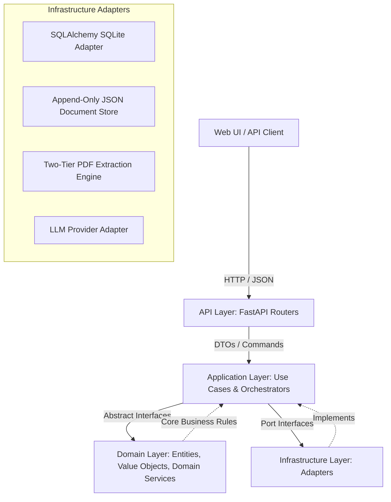
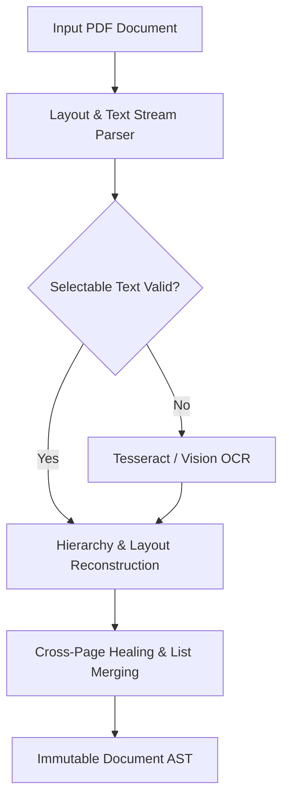
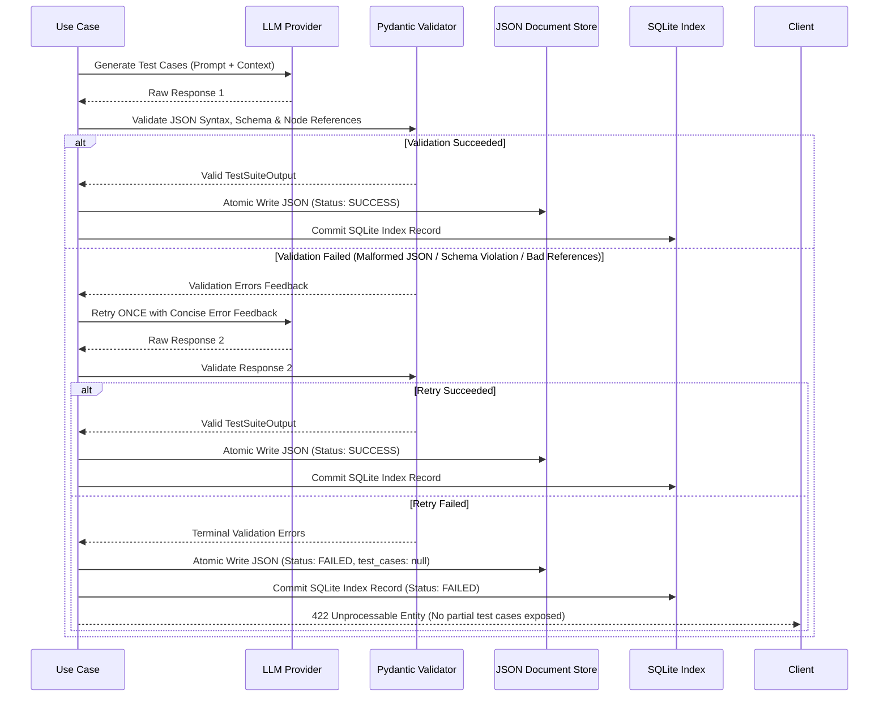

# Technical Architecture & Design Document

## 1. System Overview & Architectural Style

This system provides a robust backend for:
1. Versioned extraction and structural hierarchy reconstruction of regulatory/technical PDF manuals.
2. Content-hashed, immutable document versioning and cross-version node lineage tracking.
3. Version-pinned node selections for deterministic AI-driven test case / QA generation.
4. Validation and error-handling for LLM test case synthesis with idempotent caching.
5. Retrieval-time staleness and impact analysis with unified semantic diffs against newer manual releases.
6. Hybrid persistent storage combining relational metadata (SQLite via SQLAlchemy) and an append-only JSON/Mongo-compatible document store for generated outputs.



### Architectural Pattern: Modular Monolith
The application is structured as a **Modular Monolith** adhering to Clean / Hexagonal Architecture principles:
- **API Layer (`src/app/api`)**: Pure HTTP transport layer. Translates requests into application commands/queries and formats responses. Strict rule: **zero business logic in route handlers**.
- **Application Layer (`src/app/application`)**: Application orchestrators and use cases (`ExtractDocumentUseCase`, `GenerateTestCasesUseCase`, `CheckStalenessUseCase`). Interacts exclusively with domain models and abstract port interfaces (repositories, parsers, LLM providers).
- **Domain Layer (`src/app/domain`)**: Core business entities, value objects, domain rules, state machines, and exceptions. Independent of external libraries, frameworks, or databases.
- **Infrastructure Layer (`src/app/infrastructure`)**: Concrete adapters implementing ports defined by the application layer:
  - Database persistence via SQLAlchemy 2.0 (SQLite for relational metadata and indices).
  - Document storage via an append-only JSON document store (structured identically to MongoDB collections).
  - PDF document parsing engine (PDF text/layout first, falling back to OCR).
  - LLM client SDK integration with structured outputs and schema validators.

---

## 2. Document Model, Versioning & Cross-Version Node Identity

### 2.1 Immutability & Content Hashing
Every imported manual revision represents an immutable `DocumentVersion`. Once ingested, document versions and their constituent nodes are read-only:
- `document_id`: Stable identifier for a product line / manual family (e.g., `ct200_manual`).
- `version_id`: Monotonically increasing or semantic revision tag (e.g., `v1.0`, `v2.0`).
- `node_id`: Unique surrogate key for the specific node in that version (`doc_id:version:path_or_seq`).
- `content_hash`: Cryptographic SHA-256 digest calculated over the normalized text and structural representation of the node:
  $$\text{content\_hash} = \text{SHA256}(\text{normalized\_title} + "::" + \text{normalized\_body\_or\_table\_json})$$

### 2.2 Logical Node Identity vs. Versioned Node
Documents evolve across firmware and technical revisions. Sections are reworded, reordered, or amended. To track lineage without mutating history:
- `logical_node_id`: Represents the continuous semantic identity of a section across versions (e.g., `device_overview`, `specs.battery_life`, `alarms.error_codes`).
- Cross-version matching algorithm assigns existing `logical_node_id`s to incoming nodes in newly parsed versions.

```
Document V1 (ct200_manual.pdf)             Document V2 (ct200_manual_v2.pdf)
[Node: 2.1.1.1 Battery Life]               [Node: 2.1.1.1 Battery Life]
  - node_id: v1_node_12                      - node_id: v2_node_15
  - logical_node_id: sec_2_1_1_1             - logical_node_id: sec_2_1_1_1 (Matched)
  - content_hash: 7a8f... (300 cycles)       - content_hash: 9c3b... (250 cycles) [STALE]
```

### 2.3 Cross-Version Node Matching Heuristic
When a new document version $V_{k}$ is ingested relative to reference version $V_{k-1}$, nodes are matched using a 3-pass heuristic:
1. **Pass 1 — Strict Triple Match**:
   Match if $(\text{normalized\_heading}, \text{parent\_logical\_path}, \text{sibling\_occurrence\_index})$ are identical.
   - Example: Section `4.2 Error Codes` under `4. Alarms and Safety Behavior` matches `4.2 Error Codes` under `4. Alarms and Safety Behavior`.
2. **Pass 2 — Normalized Heading & Parent Path**:
   If numbering shifts (e.g., section renumbering) but normalized heading text and parent path match unambiguously.
3. **Pass 3 — Ambiguity & Review Flagging**:
   - If a heading appears under different parents (e.g., `Error Codes` under `4. Alarms and Safety Behavior` vs. `7. Troubleshooting`), they are strictly **distinct nodes** and must not cross-match.
   - If confidence falls below threshold (e.g., substantial text rename or relocated subtree), the node is **left unmatched** and flagged as `requires_human_review` rather than risking corrupted lineage.

---

## 3. PDF Extraction Pipeline & Confirmed Edge Cases

### 3.1 Extraction Strategy
Extraction follows a two-tier strategy:
1. **Tier 1 (Vector/Text & Layout)**:
   Extract selectable text streams, font bounding boxes, line geometry, and spatial layout coordinates (preserving reading order, indentation, and tables).
2. **Tier 2 (OCR Fallback)**:
   Triggered only if extracted text density per page is below minimum threshold or characters contain unmapped glyphs/corruption.



### 3.2 Confirmed Parser Requirements from Manual Inspection
The parser must handle the following verified characteristics from `ct200_manual.pdf` and `ct200_manual_v2.pdf`:

1. **Non-Sequential Numbering Depth (Skipped Levels)**:
   - *Observation*: Section `2.1 General Specifications` is directly followed by `2.1.1.1 Battery Life Under Typical Use` on Page 2, skipping level `2.1.1`.
   - *Requirement*: Heading hierarchy parser must preserve the declared depth (depth 4: `2.1.1.1`), attach it directly to the nearest existing numbered parent (`2.1`), and record an explicit extraction warning stating that parent `2.1.1` is missing. Do not invent an implicit section node.
2. **Out-of-Order Section Numbering in Document Flow**:
   - *Observation*: On Page 3, `3.2 Cuff Inflation Sequence` is immediately followed by `3.4 Auto Shutoff`, which is then followed by `3.3 Result Display and Classification`.
   - *Requirement*: Preserve physical source document order while recording both `source_order_index` and `logical_section_number`. Do not automatically re-sort sections based on their numeric labels.
3. **Duplicate Heading Names under Distinct Parents**:
   - *Observation*: Both `4.2 Error Codes` (under `4. Alarms and Safety Behavior`, Page 4) and `7.1 Error Codes` (under `7. Troubleshooting`, Page 6) share the title `"Error Codes"`.
   - *Requirement*: Maintain distinct nodes with unique hierarchical paths (`/alarms/error_codes` vs. `/troubleshooting/error_codes`).
4. **Table Fragment Rejection & Structural Reconstruction**:
   - *Observation*: Tables such as the General Specifications table (Page 2) and Error Codes table (Page 4) contain multi-line wrapping cells (e.g., `E2 Motion artifact detected during measurement` $\rightarrow$ `Aborts measurement, displays E2, prompts retry`). Heuristic line detectors frequently misidentify fragments as independent mini-tables.
   - *Requirement*: Table detector must perform bounding-box unioning, column alignment verification, and false-fragment suppression.
5. **Cross-Page Paragraph and Section Continuation**:
   - *Observation*:
     - Page 1 ends with an orphan section heading: `2. Physical and Electrical Specifications`. Content begins on Page 2.
     - Page 2 ends mid-sentence: *"Press and hold the power button for one second to power on the device."* and Page 3 begins: *"Use the profile button to select User 1 or User 2 before beginning a measurement..."*.
     - In V2, Section `6.1 Cleaning Instructions` splits across Page 5 and Page 6.
   - *Requirement*: Sentence boundary analysis across page breaks to join fragmented paragraphs and attach orphan headings to their corresponding subsequent body.
6. **V2 Manual Differences (Regression / Staleness Targets)**:
   - *Battery Capacity*: Section 2.1.1.1 reduced from 300 measurement cycles (15% low-battery warning) to 250 cycles (10% low-battery warning).
   - *Cuff Inflation*: Section 3.2 step increment adjusted from 40 mmHg to 30 mmHg.
   - *Overpressure Deflation Timing*: Table 4.2 Error Code E3 updated from 2.0 seconds to 1.5 seconds.
   - *New Error Code*: Table 4.2 adds `E6 Bluetooth sync failure Displays E6 on next sync` and updates Section 4.3 alarm threshold text.
   - *New Section*: Section `5.3 Data Export` added on Page 5 detailing CSV export capabilities starting with firmware 1.4.

---

## 4. Version-Pinned Selections & Storage Justification

### 4.1 Version-Pinned Node Selections & Section Expansion
When a user or automated test engineer selects nodes for QA/test case generation:
- Selections are stored as an array of exact `node_version_id` references along with snapshot content hashes.
- Pinning ensures that even when a newer manual is uploaded, previously generated test suites remain tied to the exact text and specifications from which they were derived.

#### Section Expansion Behavior
When reconstructing the generation context from an existing selection:
- **Hierarchical Expansion**: If a selected node is a `section`, all of its descendant nodes (child subsections, paragraphs, tables, lists) are recursively traversed and included.
- **Deduplication**: If the selection also directly includes a descendant node (or multiple overlapping sections), each node is included **only once**.
- **Deterministic Ordering**: Context nodes are deterministically ordered according to their physical `source_order` in the document version.
- **Audit Snapshot**: Every included node is converted into an immutable `SourceSnapshot` capturing its `node_version_id`, `logical_node_id`, `node_type`, `heading`, `section_number`, `page_start`, `page_end`, `text`, `structured_data`, and cryptographic `content_hash`.

### 4.2 Dual-Store Architecture: Relational SQLite + Append-Only Document Store

| Store | Technology | Responsibilities | Justification |
| :--- | :--- | :--- | :--- |
| **Relational Store** | SQLite 3 via SQLAlchemy 2.0 | - Document metadata & version registry<br>- Node hierarchy, paths, & `logical_node_id` mappings<br>- Pinned selection headers & generation index (`generation_index`)<br>- Fast foreign-key lookups & uniqueness constraints | ACID transactions, zero operational overhead, fast relational traversals for tree structures and search indices. |
| **Document Store** | Append-Only JSON Files (MongoDB-compatible BSON/JSON schema) | - Raw LLM prompt inputs & hyperparameter snapshots<br>- Generated test case suites (nested steps, assertions, reasoning)<br>- Validation run traces, error logs, & schema payloads | LLM outputs are semi-structured, deeply nested JSON documents with variable schemas across models and prompt templates. Append-only design guarantees auditability and zero risk of schema migration breaking historical generations. Fully compatible with MongoDB for horizontal scaling. |

#### Atomic Write & Recovery Behavior
To guarantee system consistency across dual stores without complex distributed transactions:
1. **Atomic Write Pipeline**:
   - The JSON document is serialized and written to a temporary file (`.tmp_<gen_id>_<uuid>.tmp`) in the configured `json_store_path`.
   - The file is flushed to physical media using `os.fsync`.
   - `os.replace` atomically renames the temporary file to its final destination (`<generation_id>.json`).
   - The SQLite index record (`GenerationIndexORM`) is committed after the JSON document is safely flushed to disk.
2. **Crash & Recovery Semantics**:
   - *Failure during file write*: The incomplete temporary file is discarded; no index entry exists; client receives an error.
   - *Failure after file write but before SQLite commit*: The immutable JSON document remains safely on disk. A startup reconciliation routine or recovery tool scans `json_store_path` for any `{generation_id}.json` absent from `generation_index` and reconstructs the SQLite index record.
   - *Retrieval*: Querying `GET /api/v1/generations/{generation_id}` uses the SQLite index to locate the canonical file path directly, avoiding filesystem directory scans.

---

## 5. QA / Test Case Generation, Validation & Idempotency

### 5.1 Generation Specifications & Prompt Engineering
The LLM synthesis use-case accepts:
- Selection ID pointing to a version-pinned selection.
- Mandatory `Idempotency-Key` header.
- Pluggable provider adapter (`MockLLMClient` by default, or `OpenAILLMClient` when credentials are configured).

**Prompt Versioning and Quoted Data Isolation**:
- Uses versioned prompts (`PROMPT_VERSION = "v1.0"`, `SCHEMA_VERSION = "v1.0"`).
- Quoted Source Isolation: Manual specifications are presented as raw, quoted source technical data, never as model instructions.
- Boundary Constraints: The prompt instructs the model to derive test cases solely from the quoted specifications, not to invent device behavior or claim clinical efficacy/validation.

### 5.2 Strict Output Validation Schema
The generation pipeline enforces strict Pydantic schemas (`TestSuiteOutput`, `TestCase`, `TestStep`) with `extra="forbid"`:
- **Quantity Boundary**: Requires **3 to 5 complete, executable test cases**.
- **Test Case Structure**:
  - `id`: Non-empty string identifier (e.g., `TC-001`).
  - `title`: Concise descriptive summary (non-blank).
  - `preconditions`: Non-empty list of setup prerequisites (no blank strings).
  - `steps`: Ordered list of `TestStep` (`step_number >= 1`, non-empty `action`, non-empty `expected_result`).
  - `node_references`: Non-empty list of source node-version IDs. Every reference **must exist within the generation context snapshots** (`valid_node_ids`). Unknown or out-of-context references trigger schema errors.
  - `safety_critical`: Boolean flag for alarm, threshold, or hazard verification.

### 5.3 Error Handling & One-Retry Policy


### 5.4 Duplicate & Idempotency Policy
- Requests to `POST /api/v1/selections/{selection_id}/generations` **require** the `Idempotency-Key` header.
- **Replay**: Re-submitting the same `Idempotency-Key` for the same selection immediately returns the existing generation document from storage without making any LLM call.
- **Regeneration**: Submitting a new/different `Idempotency-Key` creates a distinct generation record, even for the identical selection.

---

## 6. Retrieval-Time Staleness & Impact Analysis

When test cases or generated QA artifacts are requested, the system performs a dynamic staleness check:
1. For each `node_version_id` pinned to the generation:
   - Identify its `logical_node_id`.
   - Locate the corresponding node in the *latest* available `DocumentVersion`.
2. Determine Node State:
   - `current`: Node exists in latest version and `content_hash` matches identically.
   - `stale`: Node exists in latest version, but `content_hash` differs.
   - `removed`: Logical node does not exist in latest version.
   - `unknown`: Node cannot be mapped or reference version is missing.
3. Compute Diffs & Heuristic Impact Hints:
   - Generate unified diff between the pinned node content and latest node content.
   - Apply rule-based heuristic analyzers to tag the change:
     - `NUMERICAL_SPECIFICATION_CHANGED`: Numeric values, tolerances, or units modified (e.g., 300 $\rightarrow$ 250 cycles, 40 $\rightarrow$ 30 mmHg).
     - `SAFETY_OR_ALARM_MODIFIED`: Timing, alarm conditions, or emergency shutoffs changed (e.g., deflation valve timing 2.0s $\rightarrow$ 1.5s).
     - `FEATURE_OR_INTERFACE_ADDED`: New codes or capabilities introduced (e.g., Error E6 added, Section 5.3 Data Export).

---

## 7. Project Skeleton & Implementation Roadmap

### Directory Layout
```
data/                                # Source PDFs and raw files
  ct200_manual.pdf
  ct200_manual_v2.pdf
docs/                                # Project architecture & specifications
  architecture.md
src/
  app/
    __init__.py
    main.py                          # ASGI application entrypoint
    factory.py                       # FastAPI application factory
    config.py                        # Pydantic Settings configuration
    api/                             # HTTP Routers & Endpoints
      __init__.py
      router.py
      routes/
        __init__.py
        health.py
    application/                     # Use cases & Port Interfaces
      __init__.py
      interfaces/
        __init__.py
      use_cases/
        __init__.py
    domain/                          # Pure business entities & rules
      __init__.py
      models/
        __init__.py
    infrastructure/                  # Concrete adapters
      __init__.py
      db/
        __init__.py
      pdf/
        __init__.py
      storage/
        __init__.py
      llm/
        __init__.py
tests/                               # Automated test suite
  __init__.py
  conftest.py
  test_health.py
  test_config.py
pyproject.toml
requirements.txt
.env.example
.gitignore
```
